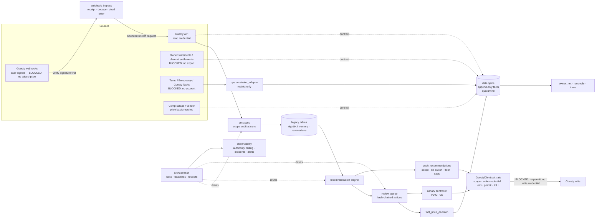

# Data flow and control points

Solid boxes are built and tested in the repository. Items marked BLOCKED need an
operator, vendor, or live authority.

Control points, in order of a live write: portfolio scope → data health
(`handle`) → operational readiness → human review → canary authorization →
final boundary (floor, caps, dates) → `set_rate` gate (scope, separate write
credential, production environment, unexpired permit, no `KILL`) → read-back →
rollback on any mismatch.
